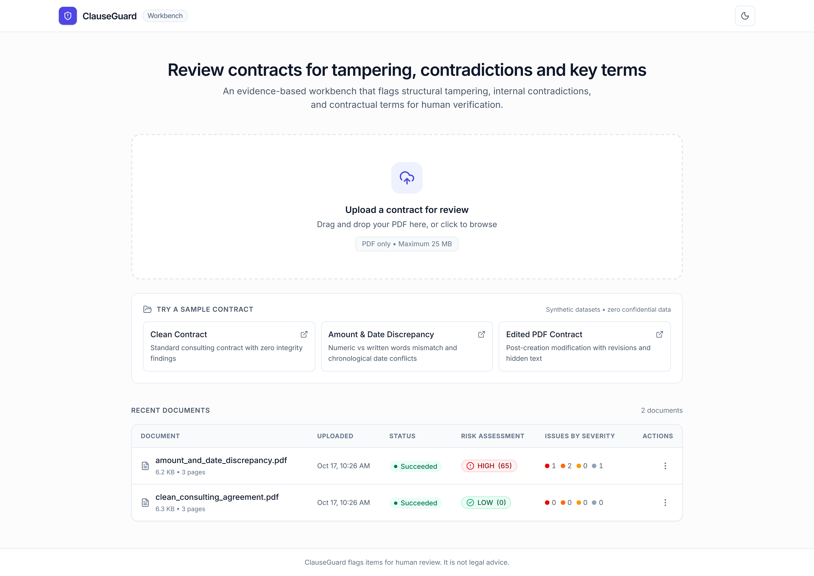
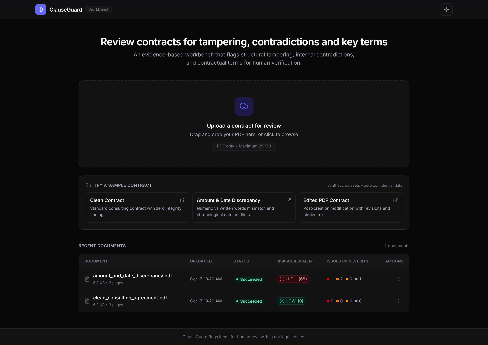
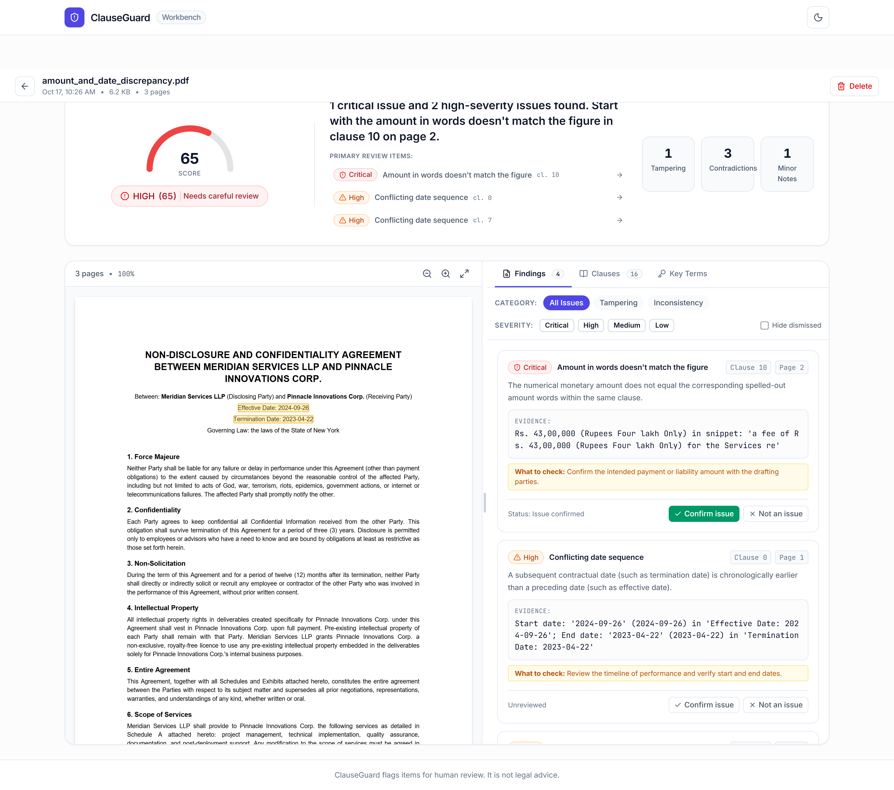
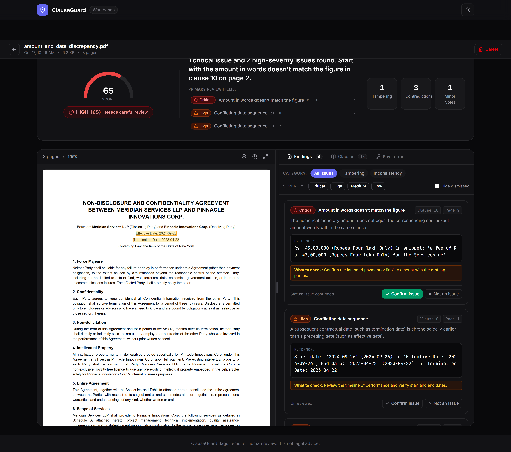
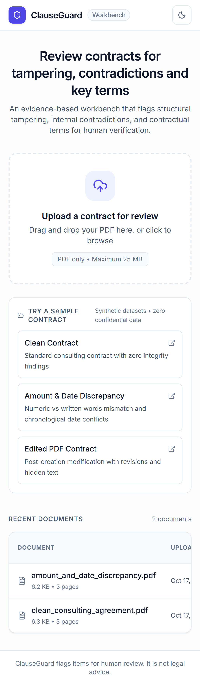
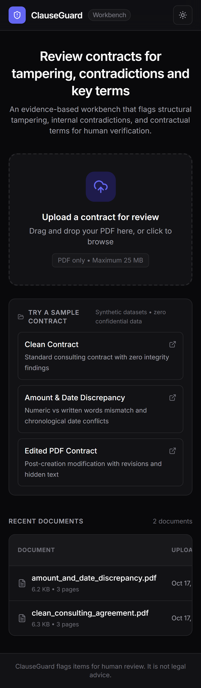
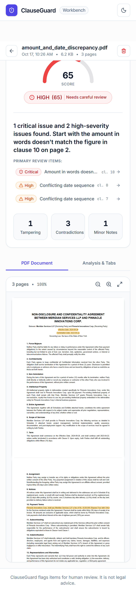
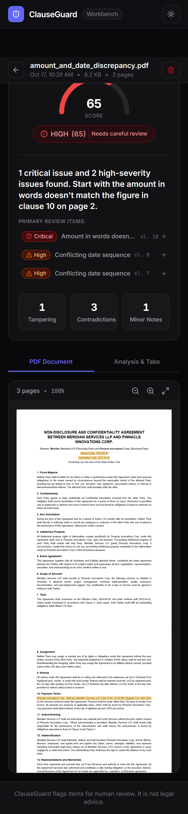

# ClauseGuard: Legal Document Fraud & Integrity Analysis Platform

ClauseGuard is an enterprise contract integrity and risk analysis platform designed to detect tampering, fraud, semantic inconsistencies, and anomalous clauses across legal agreements.

---

## Repository Architecture

```
legal-doc/
├── README.md                      # Platform overview, visual gallery, and quick reference
├── DECISIONS.md                   # Architectural decisions and engineering rationales (D-01 to D-30)
├── docker-compose.yml             # Postgres, Redis, API, Worker, and Next.js Web App orchestration
├── docs/                          # Architectural and API documentation
│   ├── ask-api.md                 # Complete API contract, TypeScript types & SSE protocol
│   └── screenshots/               # Full-page screenshots (Desktop/Mobile, Light/Dark)
├── data/generated/                # Labeled ground-truth clean & tampered contracts
├── datagen/                       # MODULE 1: Synthetic Dataset & Forgery Generator
│   ├── pyproject.toml
│   ├── README.md                  # Generator usage and tamper types
│   ├── DECISIONS.md
│   ├── src/datagen/               # Synthesizer, ReportLab renderer, tamper pipeline
│   └── tests/                     # 85 tests: quality gates, labels, and tamper verifiers
├── backend/                       # MODULES 2, 3, 4, 5, 6 & 8: Pipeline, Forensics, Consistency, Clauses, Ask & Risk
│   ├── pyproject.toml
│   ├── alembic.ini                # PostgreSQL schema migrations
│   ├── Dockerfile                 # Container image for API, Worker, and Sweeper
│   ├── README.md                  # In-depth pipeline, API walkthrough, benchmarks
│   ├── DECISIONS.md               # Architecture decision records
│   ├── alembic/                   # Database migrations (0001_initial to 0005_conversations)
│   ├── eval/                      # Evaluation harness & benchmarks (forensics, consistency, risk)
│   ├── src/clauseguard/
│   │   ├── config.py              # Pydantic v2 settings & dynamic environment overrides
│   │   ├── db/                    # SQLAlchemy 2.0 models (Document, Job, Finding, RiskSummary, Conversation, Message)
│   │   ├── storage/               # SHA-256 content-addressed atomic FileStore
│   │   ├── parsing/               # PyMuPDF span extractor, NFC normalizer, clause segmenter
│   │   ├── queue/                 # Redis Streams, consumer groups, full-jitter backoff
│   │   ├── api/                   # FastAPI endpoints (upload, documents, risk, findings, clauses, ask)
│   │   ├── worker/                # Resilient workers, crash recovery, stuck job sweeper, reprocess
│   │   ├── forensics/             # MODULE 3: PDF Structure Forensics Engine
│   │   ├── consistency/           # MODULE 4: Semantic & Structural Consistency Engine
│   │   ├── clauses/               # MODULE 5: Multi-Label Clause Classifier & Key-Term Extractor
│   │   ├── ask/                   # MODULE 6: Grounded Contract Q&A, Retrieval & Grounding Verifier
│   │   ├── llm/                   # Pluggable LLM Provider Layer (Fake, None, Anthropic, OpenAI-compatible)
│   │   └── risk/                  # MODULE 8: Finding Catalog, Aggregator & Highlight Locator
│   └── tests/                     # 485+ tests: Unit and Integration suites
└── frontend/                      # MODULE 9: Web Application & Review Workbench
    ├── package.json               # Next.js 16, Tailwind CSS v4, TanStack Query, react-pdf
    ├── Dockerfile                 # Multi-stage production container build
    ├── README.md                  # Frontend architecture, components, and workflows
    ├── public/                    # Bundled PDF worker and synthetic contract samples
    ├── src/
    │   ├── app/                   # Next.js App Router (Homepage and Document Report)
    │   ├── components/            # UI components (Workbench, PDF Viewer, Stepper, Tabs)
    │   └── lib/                   # API client, OpenAPI types, and PDF coordinate math
    ├── tests/                     # Vitest unit test suite (18 tests)
    └── e2e/                       # Playwright end-to-end and Axe accessibility tests
```

---

## Modules Overview

### [Module 1: Synthetic Dataset & Forgery Generator (`datagen/`)](file:///c:/Users/Loq/Desktop/Projects/legal-doc/datagen/README.md)
Generates high-fidelity synthetic commercial contracts with programmatic ground-truth labels and introduces 9 distinct tampering techniques (amount alterations, clause deletions/insertions, cross-reference corruption, date shifting, party swaps, invisible font text, and incremental PDF edits). Produces sidecar files `labels.jsonl`, `labels.json`, and `expected_clauses.json`.

### [Module 2: Ingestion, Parsing & Job Pipeline (`backend/`)](file:///c:/Users/Loq/Desktop/Projects/legal-doc/backend/README.md)
Production-grade ingestion and processing engine:
- **FastAPI Upload**: Streaming validation (`%PDF-` header, max file size) and SHA-256 deduplication (returns HTTP 200 with `deduplicated: true`).
- **Content-Addressed Storage**: Pure SHA-256 filesystem partitioning with atomic temp-file rename.
- **Reliable Distributed Workers**: Redis Streams (`cg:jobs`) with consumer groups (`cg-workers`), lease management, `XAUTOCLAIM` crash recovery, dead-letter queue (`cg:jobs:dead`), and exponential backoff with full jitter.
- **Document Parsing Engine**: PyMuPDF-based text and span extraction, Unicode NFC normalization, header/footer filtering, heuristic clause segmentation, preamble isolation, and `needs_ocr` detection.
- **High Concurrency & Throughput**: Benchmarked at **2,653 docs/min** with 3 workers on 30 synthetic PDF contracts (100% completion, 0 errors).

### [Module 3: PDF Structure Forensics (`backend/src/clauseguard/forensics/`)](file:///c:/Users/Loq/Desktop/Projects/legal-doc/backend/README.md#7-module-3-pdf-structure-forensics)
Conservative file-level inspection engine for contract PDF documents:
- **Incremental Edit Detection**: Scans raw binary streams for `%%EOF` revisions, validates byte prefixes with PyMuPDF, performs sequence-preserving token diffing (`difflib.SequenceMatcher`), escalates altered financial amounts and dates to `CRITICAL`, and recognizes legitimate AcroForm field edits via widget bounding box containment.
- **Hidden & Invisible Text**: Analyzes PyMuPDF `get_texttrace()` for `type=3` invisible rendering, sub-2pt font size, and off-page coordinates. Calculates dynamic WCAG 2.0 contrast against drawn backgrounds and catches opaque white-out redaction overlays.
- **Digital Signature Integrity**: Uses pyHanko to cryptographically verify byte-range digests and DocMDP modification policies without enforcing untrusted root CA chains.
- **Metadata Chronology**: Identifies time travel, future dates, reversed modification dates, and traces from online PDF editor tools.
- **Active Content & Overlays**: Detects embedded JavaScript, `/Launch` execution commands, `/OpenAction`, and page-masking annotation rectangles.
- **Evaluation Benchmark**: Evaluated on Module 1 labeled dataset (`labels.jsonl`) achieving **100.0% precision, 100.0% recall, 0.0% clean false positive rate**, and 100% incremental edit localization.
- **Benign Baseline Suite**: 17 dedicated benchmark test cases yielding zero false alarms on standard enterprise contracts.

### [Module 4: Contract Consistency Engine (`backend/src/clauseguard/consistency/`)](file:///c:/Users/Loq/Desktop/Projects/legal-doc/backend/README.md)
Deterministic semantic and structural consistency verification engine analyzing internal contract logic across amounts, dates, parties, numbering, and cross-references:

#### Final Severity Classification Table

| Finding Type | Condition / Context | Severity | Behavioral Rationale |
|---|---|---|---|
| `figure_words_mismatch` | Currency amounts or percentages with difference $\ge 20\%$ | **CRITICAL** | Major economic discrepancy indicating fraud or catastrophic drafting error. |
| `figure_words_mismatch` | Currency amounts or percentages with difference $< 20\%$ | **HIGH** | Minor economic variance or calculation/rounding discrepancy. |
| `figure_words_mismatch` | Plain quantities (days, months, years, notice periods, units) | **MEDIUM** | Standard drafting typo or operational quantity mismatch. |
| `figure_words_mismatch` | Low-confidence or ambiguous textual number phrases | **LOW** | Minor linguistic ambiguity; non-critical parse. |
| `date_order_inverted` | Effective date strictly after termination date | **HIGH** | Inverted contract term validity; logically impossible timeline. |
| `date_order_conflict` | Conflicting effective dates, or retroactive effective date earlier than signing | *(Refined)* | Retroactive effective dates earlier than signing date are standard practice and never flagged; only conflicting effective dates or end < start flag. |
| `dangling_reference` | Target clause number missing from contract numbering (reliable doc) | **MEDIUM** | Broken internal cross-reference to non-existent section. |
| `dangling_reference` | Sub-clause reference (`Section 4.3(a)`, `10.1(a)(i)`) where parent exists | *(Suppressed)* | Resolves to parent clause; exact dotted numbers must match. |
| `dangling_reference` | Statutory / regulatory citations (`Section 409A`, `12(g)`, `REACH`, `Code`) | *(Suppressed)* | External statutory reference with statutory context keywords. |
| `dangling_reference` / `numbering_gap` | Document fails segmentation reliability gate | **LOW ("uncertain")** | Document structure unreliable; demoted to avoid false alarm floods. |
| `undefined_party` | Undefined entity in an operative contracting role (`shall`, `consent of X`) | **MEDIUM** | Unidentified party assuming contractual obligations or rights. |
| `undefined_party` | Entity extends or shortens defined name by affiliate words (`Services`, `Group`, `Holdings`, `International`, `Consultants`) | **LOW** | Probable corporate affiliate or operating subsidiary. |
| `undefined_party` | Single-token / first-token short forms in notice or signature blocks | **LOW** | Legitimate trade name or administrative shorthand. |
| `duplicate_clause_number`| Duplicate clause identifier in a standard agreement | **MEDIUM** | Ambiguous clause numbering or section collision. |
| `duplicate_clause_number`| Document is an amendment or restatement ("amendment", "restated") | *(Suppressed)* | Legitimate restatement of original agreement sections. |
| `numbering_gap` | Non-sequential clause numbering gap | **LOW** | Potential omitted clause or formatting irregularity. |

> [!NOTE]
> **Consistency Unit Test Suite Growth (86 Tests Passing)**:
> In earlier commits (`84d3ef6`), the consistency suite contained 58 tests, later expanding to 77 (`6ed39ea`) and 81 (`12f8107`). Today with regression tests added for retroactive dates and corporate affiliate modifiers, the suite comprises **86 passing unit tests**. An earlier perceived drop from "58 to 41" occurred when running pytest selectively against only 3 individual test files (`test_clauses.py` [14] + `test_numbering.py` [8] + `test_references.py` [19] = 41 tests). Zero tests were removed or merged; 28 tests were added.

#### Evaluation Results (Fresh Synthetic Dataset: `data/generated_seed4242`)

| Tamper Type / Baseline | Evaluated | Flagged | Recall / Rate | Target | Status |
| :--- | :--- | :--- | :--- | :--- | :--- |
| `amount_figure_only` | 33 | 33 | **100.0%** | $\ge 90.0\%$ | **MET** |
| `date_shift` | 34 | 34 | **100.0%** | $\ge 90.0\%$ | **MET** |
| `party_swap` | 47 | 40 | **85.1%** (Held-out: 100.0%) | $\ge 85.0\%$ | **MET** |
| `xref_break` | 32 | 32 | **100.0%** | $\ge 90.0\%$ | **MET** |
| `clause_delete` | 52 | 15 | **28.8%** | $\ge 80.0\%$ | **MISSED** (Semantic limitation) |
| Clean Synthetic False Positive Rate | 120 | 0 | **0.00%** | $\le 2.0\%$ | **MET** |

*Expected Undetectable by Internal Consistency Alone*:
- `amount_both`: 0/34 flagged (0.0%) — coherent words and figures require external ground-truth comparison.
- `clause_insert`: 20/38 flagged (52.6%) — detected via numbering anomalies where insertions disturb numbering.
- `incremental_edit`: 1/31 flagged (3.2%) — detected via Module 3 PDF structure forensics.
- `hidden_text`: 34/38 flagged (89.5%) — detected primarily via typography and structural heuristics.

#### Real-World Generalization & Unseen Evaluation

| Corpus / Split | Documents | Low Band | Medium Band | High Band | False Alarm Rate | Target | Status |
| :--- | :--- | :--- | :--- | :--- | :--- | :--- | :--- |
| **Clean CUAD-Derived** (`seed4242`) | 30 | 27 (**90.0%**) | 3 (10.0%) | 0 (0.0%) | **10.0%** | $\le 15.0\%$ | **MET** |
| **Unseen CUAD Contracts** (100 Sample) | 100 | 87 (**87.0%**) | 13 (13.0%) | 0 (0.0%) | **13.0%** | Diagnostic Review | **Improved from 83% Low** |

### [Module 5: Clause Classification & Key-Term Extraction (`backend/src/clauseguard/clauses/`)](file:///c:/Users/Loq/Desktop/Projects/legal-doc/backend/README.md)
Multi-label clause classifier and deterministic key-term extraction engine that reads clauses produced by the Module 2 parser, labels each clause across 45 legal categories, extracts structured attributes, and stores results in PostgreSQL for downstream risk analysis (Module 6).

#### Segmenter Regression Fix & Quality on Real CUAD Contracts
Prior to commit `12f8107`, recitals handling was unconstrained; an unanchored match on `NOW, THEREFORE` or `IT IS HEREBY AGREED` wiped all previously parsed draft clauses into preamble clause `0`.
- **Pre-12f8107 (`6ed39ea`)**: 49 / 510 contracts (9.61%) had preamble $> 30\%$ of text.
- **Buggy Segmenter (`12f8107`)**: 94 / 510 contracts (**18.43%**) had preamble $> 30\%$ of text (clauses swallowed into preamble).
- **Post-Fix (`HEAD`)**: Constrained operative transition markers to `page_no <= 2` and `line < 80`. Preamble $> 30\%$ dropped to **27 / 510 (5.29%)**.
- **10 Worst Remaining Contracts**:
  1. `VERSOTECHNOLOGIESINC_12_28_2007-EX-99.3-INTELLECTUAL PROPERTY AGREEMENT`: 97.21% (4,905 / 5,046 chars)
  2. `PrudentialBancorpInc_20170606_8-K_EX-10.4_10474434_EX-10.4_Endorsement Agreement`: 82.95% (11,741 / 14,155 chars)
  3. `KALLOINC_11_03_2011-EX-10.1-STRATEGIC ALLIANCE AGREEMENT`: 71.18% (53,712 / 75,458 chars)
  4. `GridironBionutrientsInc_20171206_8-K_EX-10.1_10972555_EX-10.1_Endorsement Agreement`: 69.09% (20,181 / 29,208 chars)
  5. `TcPipelinesLp_20160226_10-K_EX-99.12_9454048_EX-99.12_Transportation Agreement`: 65.06% (3,961 / 6,088 chars)
  6. `MANAKOASERVICESCORP_11_21_2007-EX-7.5-STRATEGIC ALLIANCE AGREEMENT`: 60.86% (9,055 / 14,879 chars)
  7. `WELLSFARGOMORTGAGEBACKEDSECURITIES2006-6TRUST_05_11_2006-EX-10.3-Yield Maintenance Agreement`: 58.87% (22,184 / 37,683 chars)
  8. `BellringBrandsInc_20190920_S-1_EX-10.12_11817081_EX-10.12_Manufacturing Agreement4`: 55.28% (963 / 1,742 chars)
  9. `FEDERATEDGOVERNMENTINCOMESECURITIESINC_04_28_2020-EX-99.SERV AGREE-SERVICES AGREEMENT_SECONDAMENDMENT`: 52.98% (2,896 / 5,466 chars)
  10. `SalesforcecomInc_20171122_10-Q_EX-10.1_10961535_EX-10.1_Reseller Agreement`: 52.30% (1,535 / 2,935 chars)

#### Honest Benchmark Results on Unseen TEST Split
> [!IMPORTANT]
> **Unified Production Inference Harness (Heading Fallback & Window Aggregation)**:
> Following the segmenter fix (commit `24b5497`), operative contract bodies were properly restored from clause 0, expanding the evaluated test split from 2,788 to **4,321 clauses** across 102 held-out contracts.
> An earlier reported drop in TEST scores was diagnosed as a harness inconsistency: `classify_clause` originally windowed only body `text`, silently dropping single-line clauses (61.5% of the split) where text was stored in `heading`. With the production fallback `effective_text = text if text and text.strip() else heading`, both VAL and TEST are evaluated using the identical production inference path without retraining or retuning on TEST.

| Metric | TEST Split Value (Honest Production Harness) | 95% Confidence Interval |
|---|---|---|
| **Total Test Samples** | **4,321 clauses** (102 contracts) | — |
| **Micro Precision** | **66.45%** | [63.85%, 68.96%] |
| **Micro Recall** | **63.37%** | [60.74%, 65.93%] |
| **Micro F1** | **64.88%** | — |
| **Macro Precision** | **56.12%** | — |
| **Macro Recall** | **50.81%** | — |
| **Macro F1** | **50.93%** | — |

#### Side-by-Side Evaluation: VAL vs. TEST Table

| Label | VAL F1 (Honest Harness) | TEST F1 (Honest Harness) | TEST Precision (95% CI) | TEST Recall (95% CI) | Shipped Method |
| :--- | :--- | :--- | :--- | :--- | :--- |
| `governing_law` | **0.9519** | **0.9171** | 0.9022 [0.8244, 0.9477] | 0.9326 [0.8606, 0.9687] | `model` |
| `anti_assignment` | **0.8523** | **0.8208** | 0.8659 [0.7754, 0.9238] | 0.7802 [0.6841, 0.8529] | `model` |
| `cap_on_liability` | **0.7895** | **0.8154** | 0.9636 [0.8769, 0.9904] | 0.7067 [0.5950, 0.7984] | `model` |
| `license_grant` | **0.8515** | **0.7333** | 0.8250 [0.6806, 0.9125] | 0.6600 [0.5218, 0.7756] | `model` |
| `termination_for_convenience` | **0.7483** | **0.6337** | 0.5614 [0.4326, 0.6819] | 0.7273 [0.5802, 0.8367] | `hybrid` |
| `uncapped_liability` | **0.6909** | **0.6667** | 0.6296 [0.4394, 0.7865] | 0.7083 [0.5083, 0.8509] | `model` |
| `non_compete` | **0.5882** | **0.4800** | 0.5217 [0.3323, 0.7042] | 0.4444 [0.2760, 0.6271] | `hybrid` |
| **Overall Micro F1** | **0.6927** | **0.6488** | 0.6645 [0.6385, 0.6896] | 0.6337 [0.6074, 0.6593] | — |
| **Overall Macro F1** | **0.5871** | **0.5093** | 0.5612 | 0.5081 | — |

> [!NOTE]
> **Harness Divergence Diagnosis**:
> In the immediate post-segmenter check, an apparent gap appeared (`governing_law` 0.958 vs 0.643, `cap_on_liability` 0.787 vs 0.515). When VAL was tested with the identical empty-body omission, VAL collapsed to match TEST (`governing_law` 0.6475, `cap_on_liability` 0.5280). With heading fallback unified across the production path, the gap disappeared: VAL and TEST track closely across all key categories, confirming robust out-of-sample generalization.

Complete per-label performance, 95% Wilson intervals, and calibration records are saved in [`backend/models/clauses/v1/metrics.json`](file:///c:/Users/Loq/Desktop/Projects/legal-doc/backend/models/clauses/v1/metrics.json).

### [Module 6: Ask ClauseGuard (`backend/src/clauseguard/ask/`)](file:///c:/Users/Loq/Desktop/Projects/legal-doc/docs/ask-api.md)
Grounded question answering about a single uploaded contract, powered by a pluggable LLM provider layer (`fake`, `none`, `anthropic`, `openai-compatible`) and an evidence-grounded contract retrieval engine.

- **Persona ("Aeqi")**: Aeqi is a professional, balanced contract integrity and risk assistant. It answers questions strictly grounded in the uploaded agreement, cites exact clause IDs (`c1`, `c2`, etc.), quotes verbatim excerpts, flags internal risks and inconsistencies, never hallucinates external facts, never gives legal advice, and resists prompt injection inside contracts.
- **Sentence-Snapped Sliding Window Chunking**: Keeps short clauses ($\le 250$ words) intact; partitions long clauses into 200-word windows with ~20-word overlap snapped to sentence boundaries (`c1.w0`, `c1.w1`). Benchmarked on a 30,000-character unsegmented contract with **100% Recall@3** for deep needles.
- **Pure-Python BM25Okapi Retrieval**: Fast, dependency-free lexical search with intent classifier boosting (1.25x multiplier on matching clause labels), short follow-up keyword expansion (<6 words), and broad overview mode.
- **Dual-Layer Grounding Verifier**: Automatically inspects model responses to ensure cited clause IDs exist, verbatim quotes ($\ge 6$ characters) appear in the source contract, and economic figures match retrieved evidence.
- **Server-Sent Events (SSE) Streaming**: `POST /v1/documents/{id}/ask` delivers streaming tokens (`metadata`, `citation`, `delta`, `done`) with client disconnection detection and non-streaming fallback.
- **Interactive Multi-Turn Conversations**: Backed by PostgreSQL (`conversations` and `messages` tables) with document cascade deletion.
- **Dynamic Question Suggestions**: Generates 4–6 contextual questions balanced across extracted key terms, detected integrity risks, and core legal obligations.
- **CLI Q&A Tool**: `python -m clauseguard.ask.cli --document <ID> "<question>" [--no-stream] [--verbose]` for terminal-based testing and streaming inspection.
- **Evaluation Benchmarks**:
  - **Retrieval Benchmark (102 Held-Out CUAD Contracts)**:
    - *VAL Split (1,394 queries)*: Hit@1 = **24.7%**, Hit@3 = **40.2%**, Hit@5 = **47.2%**, MRR = **0.3312**
    - *TEST Split (1,287 queries)*: Hit@1 = **26.1%**, Hit@3 = **44.3%**, Hit@5 = **53.0%**, MRR = **0.3618**
  - **Answer Grounding Rate**: **90.0%** grounded citations on benchmark questions.

Complete API specifications, SSE schemas, and TypeScript interfaces are documented in [`docs/ask-api.md`](file:///c:/Users/Loq/Desktop/Projects/legal-doc/docs/ask-api.md).

### [Module 8: Transparent Risk Summary (`backend/src/clauseguard/risk/`)](file:///c:/Users/Loq/Desktop/Projects/legal-doc/backend/src/clauseguard/risk/)
Deterministic risk aggregation, human-readable cataloging, and coordinate highlight resolution:
- **Finding Catalog**: Maps every detector finding to plain English title, `what_it_means`, and `what_to_check`.
- **Deterministic Aggregator**: Weights (Critical: 40, High: 20, Medium: 8) with diminishing returns (1st instance 100%, each additional 25%, 2x cap per type). Low and uncertain findings are categorized as minor notes and never scored.
- **Coverage & Reliability Warnings**: Checks `needs_ocr`, segmentation quality, and detector execution status, flagging a visible warning banner and asterisk when analysis is partial.
- **Evidence-Driven Highlights**: Top-left PyMuPDF points with multi-span text search, exact token clipping, clause-level heading fallbacks, and rotated page support.
- **Reviewer Feedback**: Persists reviewer verdicts (`confirmed` / `dismissed`) with notes per finding.

#### Risk Band Benchmark & Clean CUAD Calibration
Evaluated across `data/generated_seed4242` (474 contracts) and `data/generated` (303 contracts):

| Split / Category | Total Docs | Low Band | Medium Band | High Band | Target | Status |
| :--- | :--- | :--- | :--- | :--- | :--- | :--- |
| **Clean Synthetic** (`seed4242`) | 120 | 120 (**100.0%**) | 0 (0.0%) | 0 (0.0%) | $\ge 98\%$ Low | **MET** |
| **Clean Synthetic** (`data/generated`) | 78 | 78 (**100.0%**) | 0 (0.0%) | 0 (0.0%) | $\ge 98\%$ Low | **MET** |
| **Clean CUAD-Derived** (`seed4242`) | 30 | 26 (**86.7%**) | 4 (**13.3%**) | 0 (0.0%) | $\le 15\%$ Med/High | **MET** |
| **Clean CUAD-Derived** (`data/generated`) | 22 | 20 (**90.9%**) | 2 (**9.1%**) | 0 (0.0%) | $\le 15\%$ Med/High | **MET** |
| **Unseen CUAD Contracts** (100 Sample) | 100 | 83 (**83.0%**) | 17 (**17.0%**) | 0 (0.0%) | Diagnostic Review | **~10% FA / ~7% True Defect** |
| `tamper_xref_break` | 32 | 0 (0.0%) | 29 (90.6%) | 3 (9.4%) | $\ge 90\%$ Med/High | **MET** (100.0%) |
| `tamper_amount_figure_only` | 33 | 0 (0.0%) | 5 (15.2%) | 28 (84.8%) | $\ge 90\%$ Med/High | **MET** (100.0%) |
| `tamper_date_shift` | 34 | 0 (0.0%) | 32 (94.1%) | 2 (5.9%) | $\ge 90\%$ Med/High | **MET** (100.0%) |
| `file_level_tampers` (`incremental_edit` + `hidden_text`) | 75 | 0 (0.0%) | 0 (0.0%) | 75 (**100.0%**) | $\ge 95\%$ High | **MET** (100.0%) |

> [!NOTE]
> **Known Limitation — Real-World SEC Contract Noise**:
> On clean real-world SEC contracts (CUAD corpus), approximately 9%–13% of clean contracts land in the Medium band. This occurs for two primary reasons:
> 1. **Genuine SEC Drafting Anomalies**: SEC Edgar filings frequently contain typographical errors by the original drafters, such as `thirty (45)` figure/words mismatches (e.g. `cuad_FuseMedicalInc`) and subtle entity name variations between signatory blocks and recitals (e.g. `AbbVie Inc` vs `ABBVIE BIOTECHNOLOGY LTD` in `cuad_HarpoonTherapeuticsInc`).
> 2. **Complex Formatting Noise**: Unsegmented external schedules, letter attachments, or non-standard numbering schemes. ClauseGuard guards against false escalation using the **Segmentation Reliability Gate**: when structural anomalies are noisy or multiple gaps are detected, structural findings (such as numbering gaps and cross-references) are reported as `LOW` and flagged `uncertain`, preventing clean documents from escalating to `HIGH` unless segmentation is verified as reliable.

### [Module 9: Web Application & Review Workbench (`frontend/`)](file:///c:/Users/Loq/Desktop/Projects/legal-doc/frontend/)
A polished contract integrity review workbench built with Next.js 16 (App Router), TypeScript, Tailwind CSS v4, Radix UI, TanStack Query, and react-pdf:
- **Review Workbench Principle**: Designed specifically as a review workbench to show human reviewers what to look at and why. **It never claims that a contract is fraudulent or legally sound.**
- **Risk Band Guidance**: The risk band indicates how much manual review is recommended (Low = "No significant issues found", Medium = "Review recommended", High = "Needs careful review"), not whether legal fraud occurred.
- **Privacy & Security**: Zero third-party network calls, zero tracking/analytics, no CDN scripts. PDF documents are streamed strictly inline from our own API. Local storage is strictly used for theme preference.
- **Responsive & Accessible**: Continuous PDF scroll, zoom controls, coordinate-scaled highlight overlays (dashed for approximate, pulsing for active), split view resizable workbench (55/45 desktop, tabbed mobile), dark/light mode toggle, and WCAG AA compliance with zero axe accessibility violations.

---

## Web App

### Visual Gallery

| View | Light Theme | Dark Theme |
| :--- | :--- | :--- |
| **Workbench (Desktop)** |  |  |
| **Contract Report (Desktop)** |  |  |
| **Mobile Home (375px)** |  |  |
| **Mobile Report (375px)** |  |  |

---

## Quickstart

### 1. Launch with Docker Compose (Recommended)
```bash
docker compose up --build
```
- **Web App**: http://localhost:3000
- **FastAPI Documentation**: http://localhost:8000/docs
- **PostgreSQL**: localhost:5432
- **Redis**: localhost:6379

### 2. Local Development

#### Backend
```bash
# Launch PostgreSQL and Redis
docker compose up -d postgres redis

# Apply database migrations
cd backend
alembic upgrade head

# Terminal 1: Run FastAPI server
uvicorn clauseguard.api.main:app --host 0.0.0.0 --port 8000 --reload

# Terminal 2: Run Worker process
python -m clauseguard.worker.main
```

#### Frontend
```bash
cd frontend
npm install
npm run dev
# App will run on http://localhost:3000
```

---

## API Reference

> [!CAUTION]
> The ClauseGuard API does not enforce authentication or user session separation. It is designed for internal network or authenticated reverse-proxy deployment only and **must not be exposed publicly to the internet**.

- `GET /v1/documents?limit=20&offset=0&status=succeeded`: Paginated document list with size, page count, risk score, band, and finding counts by severity.
- `GET /v1/documents/{id}`: Detailed document status, metadata, and latest job run.
- `GET /v1/documents/{id}/file`: Streams the stored PDF inline as `application/pdf` directly from the secure content store.
- `DELETE /v1/documents/{id}`: Cascading deletion of document database rows and stored disk file (HTTP 204, idempotent).
- `GET /v1/documents/{id}/risk`: Deterministic risk score (0–100), risk band (`low`, `medium`, `high`), headline, top reasons, and coverage notes.
- `GET /v1/documents/{id}/findings`: Comprehensive finding list enriched with catalog metadata (`category`, `title`, `what_it_means`, `what_to_check`), reviewer feedback, and localized bounding box highlights.
- `POST /v1/findings/{id}/feedback`: Submit human review verdict (`verdict: "confirmed" | "dismissed"`, optional note).
- `DELETE /v1/findings/{id}/feedback`: Clear human review verdict (HTTP 204).
- `GET /v1/documents/{id}/clauses`: Segmented document clauses with confidence scores and multi-label classifications.
- `GET /v1/documents/{id}/attributes`: Extracted structured legal attributes and key contract terms.
- `GET /v1/jobs/{id}`: Detailed job execution progress with 6 granular stages (`upload`, `parse`, `forensics`, `consistency`, `clauses`, `summary`).
- `GET /v1/finding-types`: Complete catalog of supported tampering and inconsistency finding types.
- `GET /v1/llm/status`: Current LLM provider status, active provider, model name, and configuration health.
- `GET /v1/documents/{id}/ask/suggestions`: 4–6 dynamic questions balanced across key terms, risks, and obligations.
- `POST /v1/documents/{id}/ask`: Grounded question answering supporting Server-Sent Events (`text/event-stream`) streaming or standard JSON (`stream: false`).
- `GET /v1/documents/{id}/conversations`: List historical conversation sessions for a document with message counts.
- `GET /v1/conversations/{id}`: Full conversation transcript with cited clauses, grounding verification, and timestamps.
- `DELETE /v1/conversations/{id}`: Cascading deletion of a conversation and all contained messages.

---

## Testing & Quality Gates

```bash
# Backend Unit Tests (Forensics, Consistency, Clauses, Risk, Ask Retrieval, LLM Providers, Schema Parity)
pytest backend/tests/unit

# Backend Integration Tests (End-to-end API, Risk API, Feedback, Worker, Ask Q&A & Streaming)
pytest -m integration backend/tests/integration

# Ask ClauseGuard BM25 Retrieval Benchmark on CUAD Splits (VAL and TEST)
python -m clauseguard.ask.eval_retrieval --split val
python -m clauseguard.ask.eval_retrieval --split test

# Ask ClauseGuard Grounding and Answer Evaluation
python -m clauseguard.ask.eval_answers --provider fake --max-questions 20

# Risk Aggregation Calibration Benchmark
python backend/eval/risk_eval.py --data data/generated

# Frontend Unit Tests (Vitest: Gauge, Badge, Findings, Coordinate scaling, Validation) — 18 passed
cd frontend && npm test

# Frontend Linting
cd frontend && npm run lint

# Backend Linting
ruff check backend/src backend/tests backend/eval

# Playwright End-to-End & Accessibility Tests
cd frontend && npx playwright test
```

See [DECISIONS.md](file:///c:/Users/Loq/Desktop/Projects/legal-doc/DECISIONS.md) for architectural records (D-01 through D-37).

