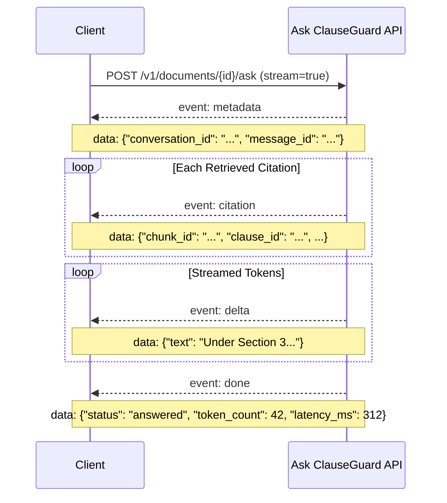

# Ask ClauseGuard API Specification

This document specifies the complete REST and Server-Sent Events (SSE) API for **Module 6: Ask ClauseGuard** (AI Assistant persona: **Aeqi**).

This specification is designed for frontend developers building user interfaces in a separate repository or client application.

---

## 1. Overview & Architecture

Ask ClauseGuard provides **grounded question answering** over single uploaded legal contracts.

### Core Principles
1. **Factual Grounding**: Answers are synthesized strictly from retrieved contract excerpts.
2. **Verified Citations**: Every answer provides clause IDs (`[1.1]`, `[c1.w0]`), headings, page numbers, and verbatim snippets.
3. **No Legal Advice**: Aeqi is an automated contract integrity assistant for informational purposes only.
4. **Prompt Injection Defense**: Untrusted contract text is sandboxed in `<contract_context>` delimiters; instructions embedded inside contract text are never executed.
5. **Privacy First**: Sensitive personal identifying information (PII) is protected; contracts are processed only in-memory and never used for model training.

---

## 2. Endpoints

| Method | Endpoint | Description |
|---|---|---|
| `GET` | `/v1/llm/status` | Check AI provider availability, active model, persona, and legal disclaimers. |
| `GET` | `/v1/documents/{document_id}/ask/suggestions` | Fetch 4–6 dynamic question suggestions tailored to the contract. |
| `POST` | `/v1/documents/{document_id}/ask` | Submit a question. Supports SSE streaming (default) or JSON response. |
| `GET` | `/v1/documents/{document_id}/conversations` | List persistent conversation threads for a document. |
| `GET` | `/v1/conversations/{conversation_id}` | Fetch full message history and citations for a conversation. |
| `DELETE` | `/v1/conversations/{conversation_id}` | Delete a conversation thread and its messages. |

---

## 3. Endpoint Specifications

### 3.1 `GET /v1/llm/status`
Returns service availability, persona information, and mandatory disclaimers. Does **not** leak API keys.

#### Response (`200 OK`)
```json
{
  "provider": "anthropic",
  "model": "claude-3-5-sonnet-20241022",
  "available": true,
  "streaming": true,
  "assistant_name": "Aeqi",
  "persona": "Aeqi",
  "consent_required": true,
  "consent_text": "Contract excerpts are processed by the configured AI provider strictly to answer your questions. No contract data is used for model training.",
  "consent_notice": "Contract excerpts are processed by the configured AI provider strictly to answer your questions. No contract data is used for model training.",
  "disclaimer": "Aeqi provides automated contract analysis for informational purposes only and does not provide legal advice."
}
```

---

### 3.2 `GET /v1/documents/{document_id}/ask/suggestions`
Returns 4 to 6 dynamic, document-tailored starter questions based on extracted key attributes, risk bands, and forensics findings.

#### Response (`200 OK`)
```json
{
  "document_id": "b122302e-8fab-467a-8f9b-1da584e2554e",
  "suggestions": [
    {
      "id": "sug_1",
      "question": "What are the governing law and dispute resolution rules under Delaware law?",
      "category": "key_terms",
      "target_clause_id": null
    },
    {
      "id": "sug_2",
      "question": "How does the limitation of liability clause allocate damages and liability caps?",
      "category": "key_terms",
      "target_clause_id": null
    },
    {
      "id": "sug_3",
      "question": "What are the requirements and conditions for termination upon 60 days notice?",
      "category": "obligations",
      "target_clause_id": null
    },
    {
      "id": "sug_4",
      "question": "Where was hidden or suspicious text detected in this contract and what does it say?",
      "category": "risks",
      "target_clause_id": null
    }
  ]
}
```

---

### 3.3 `POST /v1/documents/{document_id}/ask`
Submits a user question for grounded question answering.

#### Request Body
```json
{
  "question": "What is the limitation of liability cap?",
  "conversation_id": "optional-uuid-to-continue-thread",
  "stream": true
}
```

- `question` (string, required): 1 to 2000 characters.
- `conversation_id` (UUID, optional): If omitted, a new conversation is automatically created.
- `stream` (boolean, default: `true`): When `true`, streams via Server-Sent Events (SSE). When `false`, returns standard JSON.

#### Non-Streaming Response (`200 OK`, when `stream: false`)
```json
{
  "conversation_id": "3fa85f64-5717-4562-b3fc-2c963f66afa6",
  "message_id": "7c9e6679-7425-40de-944b-e07fc1f90ae7",
  "question": "What is the limitation of liability cap?",
  "answer": "Under Section 3 (Limitation of Liability), each party's aggregate liability is capped at $500,000.",
  "citations": [
    {
      "chunk_id": "3",
      "clause_id": "3",
      "heading": "LIMITATION OF LIABILITY",
      "page": 1,
      "text_snippet": "In no event shall either party's aggregate liability under this agreement exceed $500,000."
    }
  ],
  "status": "answered",
  "verification_kind": "answered",
  "token_count": 42,
  "latency_ms": 310
}
```

- `verification_kind` (string, `"answered"` | `"abstention"`): Indicates whether the answer is substantive grounding against contract excerpts (`"answered"`) or an explicit declaration that the contract does not contain the requested information (`"abstention"`).
- When `verification_kind == "abstention"`, the answer begins with `"The contract does not say "` followed by a clause naming what was searched for. Abstentions need no citation and do not count as ungrounded citations. The verifier marks them `verified=true` with `kind="abstention"`.


---

## 4. Server-Sent Events (SSE) Protocol

When `stream: true`, the endpoint responds with `Content-Type: text/event-stream`.

### Event Flow



### Event Types

#### `event: metadata`
Sent immediately after request validation.
```
event: metadata
data: {"conversation_id": "3fa85f64-5717-4562-b3fc-2c963f66afa6", "message_id": "7c9e6679-7425-40de-944b-e07fc1f90ae7"}

: keep-alive

```
*(Note: An immediate SSE `: keep-alive\n\n` comment is emitted right after `metadata` to prevent intermediary proxy timeouts while the LLM provider completes its initial reasoning step).*

#### `event: citation`
Sent for each retrieved citation backing the answer before tokens begin streaming.
```
event: citation
data: {"chunk_id": "4", "clause_id": "4", "heading": "GOVERNING LAW", "page": 1, "text_snippet": "This Agreement shall be governed by and construed in accordance with the laws of the State of Delaware."}

```

#### `event: delta`
Incremental text tokens generated by Aeqi.
```
event: delta
data: {"text": "Under Delaware "}

event: delta
data: {"text": "law, the agreement..."}

```

#### `event: done`
Signals completion of response and reports token counts, latency, verification kind, and whether suspicious hidden text was detected and excluded.
```
event: done
data: {"status": "answered", "verification_kind": "answered", "token_count": 42, "latency_ms": 312, "hidden_text_excluded": false}

```

---

## 5. Security, Rate Limiting & Privacy

### 5.1 Per-Document Rate Limiting
To prevent denial-of-service and avoid exhausting upstream LLM quota, `POST /v1/documents/{document_id}/ask` implements an in-memory sliding window rate limiter:
- **Limit**: 20 requests per document per minute (`max_per_min = 20`).
- **Response**: `HTTP 429 Too Many Requests` with header `Retry-After: 60` and payload:
  ```json
  {"detail": "Rate limit exceeded for this document. Please wait a minute before asking more questions."}
  ```

### 5.2 Hidden Text Exclusion
Text detected as suspicious or hidden by Module 3 PDF forensics (such as `white_on_white` contrast evasion, `render_mode_3` invisible text, or `sub_1pt_font` microscopic spans) is **strictly excluded** from the model prompt context to prevent invisible prompt injection attacks.
When hidden spans are detected, the API sets `hidden_text_excluded: true` in the final response and SSE `done` event.

### 5.3 Algorithmic & Contextual PII Redaction
Before contract excerpts reach any external provider, sensitive identifiers are sanitized:
- **Aadhaar**: 12-digit numbers with or without delimiters, cryptographically validated using the **Verhoeff checksum algorithm**.
- **PAN**: Permanent Account Numbers matching `[A-Z]{5}[0-9]{4}[A-Z]`.
- **Payment Cards**: 13 to 19 digit card numbers validated via the **Luhn algorithm**.
- **Bank Account Numbers**: 9 to 18 digits masked strictly when near context keywords (`account`, `a/c`, `acct`, `ifsc`, `banking`).
- **IFSC Codes**: `[A-Z]{4}0[A-Z0-9]{6}`.
- **Negative Guardrails**: Genuine contract numbers (`AGR-2024-001`), invoice IDs, amounts in lakh/crore, clause numbers (`Section 4.1.2`), dates, PIN codes, and non-phone 10-digit numbers are preserved untouched.
- **Reversible Restoration**: Masked tokens are restored in the final user-visible response after verification.

*Possible `status` values:*
- `"answered"`: Normal grounded answer generated with citations.
- `"insufficient_evidence"`: The contract context does not contain sufficient information to answer the question.
- `"retrieve_only"`: Fallback mode when LLM is unavailable; client can still display the retrieved citations.

---

## 5. Conversation History Endpoints

### 5.1 `GET /v1/documents/{document_id}/conversations`
List all persistent threads for a document.

#### Response (`200 OK`)
```json
[
  {
    "id": "3fa85f64-5717-4562-b3fc-2c963f66afa6",
    "document_id": "b122302e-8fab-467a-8f9b-1da584e2554e",
    "title": "What is the governing law of the contract?",
    "message_count": 4,
    "created_at": "2026-10-17T05:30:00.000000Z",
    "updated_at": "2026-10-17T05:32:00.000000Z"
  }
]
```

### 5.2 `GET /v1/conversations/{conversation_id}`
Fetch complete thread history with verified citations.

#### Response (`200 OK`)
```json
{
  "id": "3fa85f64-5717-4562-b3fc-2c963f66afa6",
  "document_id": "b122302e-8fab-467a-8f9b-1da584e2554e",
  "title": "What is the governing law of the contract?",
  "created_at": "2026-10-17T05:30:00.000000Z",
  "updated_at": "2026-10-17T05:32:00.000000Z",
  "messages": [
    {
      "id": "11111111-1111-1111-1111-111111111111",
      "role": "user",
      "content": "What is the governing law?",
      "citations": null,
      "token_count": null,
      "latency_ms": null,
      "created_at": "2026-10-17T05:30:00.000000Z"
    },
    {
      "id": "22222222-2222-2222-2222-222222222222",
      "role": "assistant",
      "content": "Under Section 4, this Agreement is governed by Delaware law.",
      "citations": [
        {
          "chunk_id": "4",
          "clause_id": "4",
          "heading": "GOVERNING LAW",
          "page": 1,
          "text_snippet": "This Agreement shall be governed by and construed in accordance with the laws of Delaware."
        }
      ],
      "token_count": 28,
      "latency_ms": 240,
      "created_at": "2026-10-17T05:30:02.000000Z"
    }
  ]
}
```

### 5.3 `DELETE /v1/conversations/{conversation_id}`
Deletes the conversation and cascades to all its messages.

#### Response (`204 No Content`)

---

## 6. TypeScript Types (Copy-Paste Ready)

```typescript
export interface LLMStatusResponse {
  provider: string;
  model: string;
  available: boolean;
  streaming: boolean;
  assistant_name: string;
  persona: string;
  consent_required: boolean;
  consent_text: string;
  consent_notice: string;
  disclaimer: string;
}

export interface AskSuggestion {
  id: string;
  question: string;
  category: 'key_terms' | 'risks' | 'obligations' | 'general';
  target_clause_id?: string | null;
}

export interface AskSuggestionsResponse {
  document_id: string;
  suggestions: AskSuggestion[];
}

export interface Citation {
  chunk_id: string;
  clause_id: string;
  heading?: string | null;
  page: number;
  text_snippet: string;
}

export interface AskRequest {
  question: string;
  conversation_id?: string | null;
  stream?: boolean;
}

export interface AskAnswerResponse {
  conversation_id: string;
  message_id: string;
  question: string;
  answer: string;
  citations: Citation[];
  status: 'answered' | 'insufficient_evidence' | 'retrieve_only';
  verification_kind?: 'answered' | 'abstention' | null;
  token_count?: number | null;
  latency_ms?: number | null;
  hidden_text_excluded?: boolean;
}

export interface MessageItem {
  id: string;
  role: 'user' | 'assistant';
  content: string;
  citations?: Citation[] | null;
  token_count?: number | null;
  latency_ms?: number | null;
  created_at: string;
}

export interface ConversationListItem {
  id: string;
  document_id: string;
  title?: string | null;
  message_count: number;
  created_at: string;
  updated_at: string;
}

export interface ConversationDetailResponse {
  id: string;
  document_id: string;
  title?: string | null;
  created_at: string;
  updated_at: string;
  messages: MessageItem[];
}

export interface SSEMetadataEvent {
  conversation_id: string;
  message_id: string;
}

export interface SSEDoneEvent {
  status: 'answered' | 'insufficient_evidence' | 'retrieve_only';
  token_count: number;
  latency_ms: number;
}
```

---

## 7. Frontend Integration Example (ReadableStream)

Here is a production-ready helper to stream answers in React or vanilla TypeScript:

```typescript
export async function streamAskQuestion(
  documentId: string,
  question: string,
  callbacks: {
    onMetadata?: (meta: SSEMetadataEvent) => void;
    onCitation?: (citation: Citation) => void;
    onDelta?: (text: string) => void;
    onDone?: (done: SSEDoneEvent) => void;
    onError?: (err: Error) => void;
  },
  conversationId?: string,
  apiBase: string = 'http://localhost:8000'
): Promise<void> {
  const url = `${apiBase}/v1/documents/${documentId}/ask`;
  const response = await fetch(url, {
    method: 'POST',
    headers: { 'Content-Type': 'application/json' },
    body: JSON.stringify({
      question,
      conversation_id: conversationId,
      stream: true,
    }),
  });

  if (!response.ok) {
    throw new Error(`Ask API error: ${response.status} ${response.statusText}`);
  }

  const reader = response.body?.getReader();
  if (!reader) throw new Error('ReadableStream not supported.');

  const decoder = new TextDecoder('utf-8');
  let buffer = '';

  while (true) {
    const { done, value } = await reader.read();
    if (done) break;

    buffer += decoder.decode(value, { stream: true });
    const lines = buffer.split('\n\n');
    buffer = lines.pop() || '';

    for (const block of lines) {
      if (!block.trim()) continue;
      const eventMatch = block.match(/^event:\s*(\w+)/m);
      const dataMatch = block.match(/^data:\s*(.+)$/m);

      if (eventMatch && dataMatch) {
        const eventType = eventMatch[1];
        const data = JSON.parse(dataMatch[1]);

        if (eventType === 'metadata') callbacks.onMetadata?.(data);
        else if (eventType === 'citation') callbacks.onCitation?.(data);
        else if (eventType === 'delta') callbacks.onDelta?.(data.text);
        else if (eventType === 'done') callbacks.onDone?.(data);
      }
    }
  }
}
```

---

## 8. Error Contract & Graceful Fallbacks

| Status Code | Code | Description | Client Action |
|---|---|---|---|
| `404` | `not_found` | Document or conversation does not exist. | Inform user that the document was removed. |
| `422` | `validation_error` | Empty question or input > 2000 chars. | Prompt user to adjust question length. |
| `503` | `llm_unavailable` | External LLM provider unreachable or disabled. | Client should fall back to display retrieved citations directly (`status: "retrieve_only"`). |
